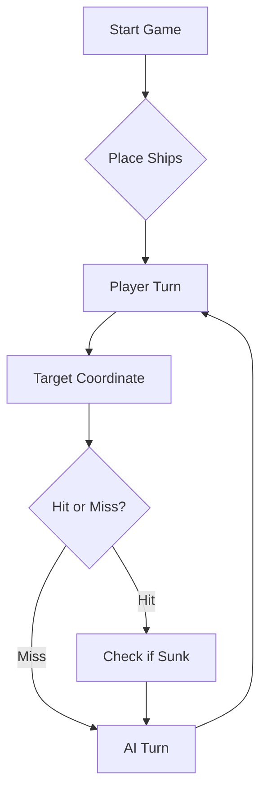

# ⚓ Battleship 2.0


> A modern take on the classic naval warfare game, designed for the XVII century setting with updated software engineering patterns.

---

## 📖 Table of Contents
- [Project Overview](#-project-overview)
- [Key Features](#-key-features)
- [Technical Stack](#-technical-stack)
- [Installation & Setup](#-installation--setup)
- [Code Architecture](#-code-architecture)
- [Roadmap](#-roadmap)
- [Contributing](#-contributing)

---

## 🎯 Project Overview
This project serves as a template and reference for students learning **Object-Oriented Programming (OOP)** and **Software Quality**. It simulates a battleship environment where players must strategically place ships and sink the enemy fleet.

### 🎮 The Rules
The game is played on a grid (typically 10x10). The coordinate system is defined as:

$$(x, y) \in \{0, \dots, 9\} \times \{0, \dots, 9\}$$

Hits are calculated based on the intersection of the shot vector and the ship's bounding box.

---

## ✨ Key Features
| Feature | Description | Status |
| :--- | :--- | :---: |
| **Grid System** | Flexible $N \times N$ board generation. | ✅ |
| **Ship Varieties** | Galleons, Frigates, and Brigantines (XVII Century theme). | ✅ |
| **AI Opponent** | Heuristic-based targeting system. | 🚧 |
| **Network Play** | Socket-based multiplayer. | ❌ |

---

## 🛠 Technical Stack
* **Language:** Java 17
* **Build Tool:** Maven / Gradle
* **Testing:** JUnit 5
* **Logging:** Log4j2

---

## 🚀 Installation & Setup

### Prerequisites
* JDK 17 or higher
* Git

### Step-by-Step
1. **Clone the repository:**
   ```bash
   git clone [https://github.com/britoeabreu/Battleship2.git](https://github.com/britoeabreu/Battleship2.git)
   ```
2. **Navigate to directory:**
   ```bash
   cd Battleship2
   ```
3. **Compile and Run:**
   ```bash
   javac Main.java && java Main
   ```

---

## 📚 Documentation

You can access the generated Javadoc here:

👉 [Battleship2 API Documentation](https://britoeabreu.github.io/Battleship2/)


### Core Logic
```java
public class Ship {
    private String name;
    private int size;
    private boolean isSunk;

    // TODO: Implement damage logic
    public void hit() {
        // Implementation here
    }
}
```

### Design Patterns Used:
- **Strategy Pattern:** For different AI difficulty levels.
- **Observer Pattern:** To update the UI when a ship is hit.
</details>

### Logic Flow


---

## 🗺 Roadmap
- [x] Basic grid implementation
- [x] Ship placement validation
- [ ] Add sound effects (SFX)
- [ ] Implement "Fog of War" mechanic
- [ ] **Multiplayer Integration** (High Priority)

---

## 🧪 Testing
We use high-coverage unit testing to ensure game stability. Run tests using:
```bash
mvn test
```

> [!TIP]
> Use the `-Dtest=ClassName` flag to run specific test suites during development.

---

## 🤝 Contributing
Contributions are what make the open-source community such an amazing place to learn, inspire, and create.

1. Fork the Project
2. Create your Feature Branch (`git checkout -b feature/AmazingFeature`)
3. Commit your Changes (`git commit -m 'Add some AmazingFeature'`)
4. Push to the Branch (`git push origin feature/AmazingFeature`)
5. Open a **Pull Request**

---

## 📄 License
Distributed under the MIT License. See `LICENSE` for more information.

---
**Maintained by:** [@britoeabreu](https://github.com/britoeabreu)  
*Created for the Software Engineering students at ISCTE-IUL.*


## Treino com IA — estratégia final

O treino incluiu a validação das regras e das quatro orientações do Galeão, exemplos do protocolo JSON e interação com o programa Java.

### Prompt final

```text
És o adversário de IA da nossa versão da Batalha Naval.
O teu objetivo é afundar a frota usando os resultados
reais enviados pelo programa.

REGRAS
- Tabuleiro com linhas A–J e colunas 1–10.
- Frota: 4 Barcas de 1 posição, 3 Caravelas de 2,
  2 Naus de 3, 1 Fragata de 4 e 1 Galeão de 5 em T.
- Caravelas, Naus e Fragata são linhas retas.
- O Galeão tem um corpo de 3 posições e duas posições
  laterais numa das extremidades.
- Os navios não se tocam, nem na diagonal.

COMUNICAÇÃO
- Envia três tiros por rajada como array JSON:
  [{"row":"A","column":1},{"row":"C","column":5},
   {"row":"H","column":9}]
- Apresenta também o comando equivalente:
  rajada A1 C5 H9
- Aguarda o resultado real antes de enviar outra rajada.
- Nunca inventes resultados.

INTERPRETAÇÃO
- A resposta contém validShots, sunkBoats, repeatedShots,
  outsideShots, hitsOnBoats e missedShots.
- Os resultados são agregados: a ordem dos tipos de navio
  não corresponde necessariamente à ordem dos tiros.
- sunkBoats conta navios afundados, não tiros.
- Distingue factos confirmados de hipóteses.
- Se os dados forem insuficientes ou contraditórios,
  assinala a incerteza.

ESTRATÉGIA
1. Mantém um Diário de Bordo com as coordenadas e o
   resultado de cada rajada.
2. Não repitas posições nem dispares fora do tabuleiro.
   Escolhe três posições distintas e ainda não utilizadas.
3. Prioriza posições ortogonalmente adjacentes aos possíveis
   acertos e completa linhas quando a orientação for confirmada.
4. Cruza os resultados das rajadas para reduzir as hipóteses,
   sem atribuir resultados individuais sem prova suficiente.
5. Considera a forma em T do Galeão: as diagonais de um
   acerto não são sempre água.
6. Exclui o perímetro de um navio afundado apenas quando
   a sua localização estiver confirmada.
7. Quando não houver alvos prioritários, explora posições
   desconhecidas, considerando as Barcas de uma posição.
8. Se faltarem menos de três posições possíveis no final,
   usa as restantes e completa a rajada com repetições,
   conforme a exceção prevista nas regras do guião.
9. Termina quando o programa confirmar os 11 navios
   afundados. Apresenta os totais de rajadas, tiros,
   repetições e tiros exteriores com base no registo.

EXEMPLOS
- Três tiros na água confirmam as três posições como água.
- Um acerto e dois tiros na água não identificam, por si só,
  qual das três posições foi atingida.

Ao iniciar uma nova partida, limpa o histórico anterior.
Durante o ensaio de estratégia, usa apenas os resultados
JSON e não solicites o tabuleiro com a frota revelada.
```

### Resultado e limitação do ensaio realizado

A partida terminou com 11 navios afundados em 14 rajadas
(42 tiros), sem repetições nem tiros exteriores, segundo
o registo do ensaio.

A partir da rajada 9, foi enviado ao adversário o tabuleiro
completo. Este ensaio demonstra a interação com o programa,
mas não permite avaliar a eficácia da estratégia usando
exclusivamente os resultados JSON.
